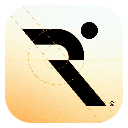
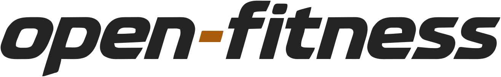
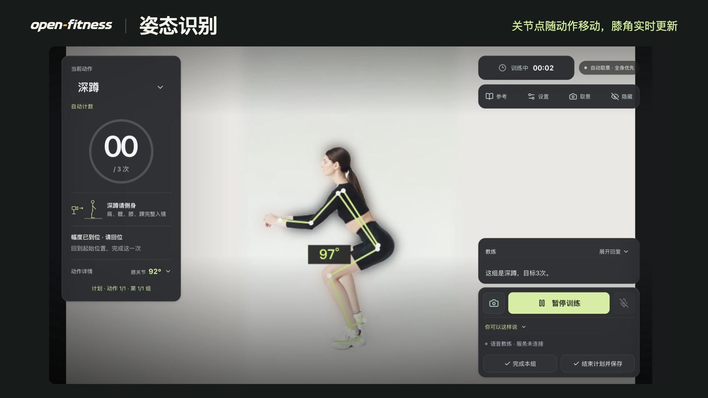

<h1>
  
  <picture>
    <source media="(prefers-color-scheme: dark)" srcset="desktop/assets/branding/navigation-wordmark.svg">
    
  </picture>
</h1>

[简体中文](README.md) · **English** · [Product website and demo](https://echonoshy.github.io/open-fitness/)

**A camera-guided AI fitness coach for Apple Silicon Macs.** Use your camera to track movement and talk to the coach while you train. Start with a set of squats, or build your own workout from a library of 582 exercises.

## Product tour

[](website/preview-media/open-fitness-tour.mp4?raw=true)

[Watch the 50-second demo (MP4, Mandarin audio)](website/preview-media/open-fitness-tour.mp4?raw=true) · See how to choose an exercise, start a plan and count squats with the camera. Hear the coach answer a question mid-workout. The demo uses prerecorded movement footage as its camera input.

## Start a workout

1. Drag `open-fitness.app` into Applications and open it. Select your camera in Settings and grant camera access when macOS prompts you.
2. On the Training screen, select squats and start a set. Stand side-on with your shoulder, hip, knee and ankle in view. Complete a squat and return to standing to see the rep count.
3. To ask the coach a question or change a target by voice, enter your Agent Plan key under Settings → AI Services. Test the connection, save it, and turn on the microphone.

**Basic training works without an API key.** You can browse exercises, build plans, count reps or time holds for supported movements, and save workouts. Camera footage and pose analysis stay on your Mac. When you enable the online voice coach, audio clips, conversation and relevant workout context are sent to the services you configure.

## Exercises, plans and history

| What you want to do | How it works |
| --- | --- |
| Find an exercise | Search in Chinese or English, filter by muscle group, equipment or difficulty, and save exercises to your favorites. |
| Track movement | The camera counts reps for supported exercises such as squats and push-ups, and times plank holds. Other exercises are labeled for estimated reps, timing or manual logging. |
| Repeat a workout | Arrange exercises, sets, rep or time targets, loads and rest periods in a plan. Save it and start it again next time. |
| Review or back up your training | Open History to review your workouts. Use JSON for a full backup, or exchange supported records using Strong or Hevy CSV files. |

## Run from source

Install Node.js and npm, then run the following commands from the repository root. The first install downloads dependencies and the pose model. The app runs without Python.

```sh
cd desktop
npm ci
npm run dev
```

From the same directory, run `npm run web` to start the browser app. The desktop and browser apps store training data separately. Use `npm test` for the regression suite and `npm run package:public` on a Mac to build a distributable app without a personal key. The [developer guide](desktop/README.md) lists the environment requirements and other commands.

## Documentation and licensing

Further reading in Chinese

[User guide](docs/trial-guide.md) · [validation and known limitations](docs/validation.md) · [coach voices](docs/voices.md).

The project's own code is licensed under PolyForm Noncommercial. Commercial use requires separate permission. The original app icon and designated documentation use a Creative Commons Attribution-NonCommercial license. Third-party exercise footage, models and audio have their own terms. See the [code license](LICENSE), [asset licenses and credits](ASSET-LICENSES.md) and [project sources](docs/sources.md).
