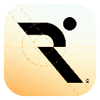
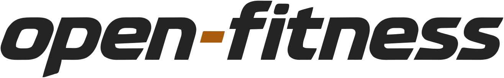
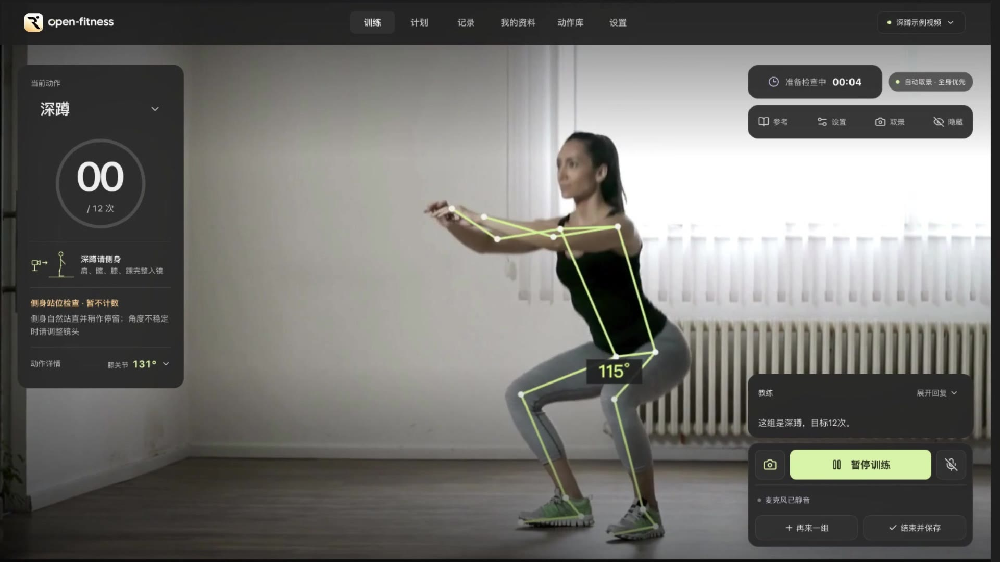

<h1>
  
  <picture>
    <source media="(prefers-color-scheme: dark)" srcset="desktop/assets/branding/navigation-wordmark.svg">
    
  </picture>
</h1>

**简体中文** · [English](README.en.md)

**你的 AI 视觉私教。** 在配备 Apple 芯片的 Mac 上，用摄像头记录动作，用声音和教练交流。你可以从一组深蹲开始，也可以从 582 个动作中挑选、编排自己的训练计划。

## 产品介绍视频

[](website/preview-media/open-fitness-tour.mp4?raw=true)

[观看 50 秒实机演示（MP4）](website/preview-media/open-fitness-tour.mp4?raw=true) · 看看如何挑选动作、开始计划、用摄像头数深蹲，以及训练中教练如何用语音回答提问。演示中的摄像头画面使用预录动作样本。

## 开始训练

1. 将 `open-fitness.app` 拖到「应用程序」并打开。在设置中选择摄像头，按系统提示授权。
2. 在「训练」页选择深蹲并开始。按提示侧身站好，让肩、髋、膝、踝完整入镜，完成一次深蹲后回到站姿，查看计数。
3. 想在训练中提问或调整目标时，在「设置 → AI 服务」填入自己的 Agent Plan Key，测试通过后保存，并开启麦克风。

**基础训练无需 API Key。** 动作库、计划、受支持动作的摄像头计次或计时，以及训练记录都可以单独使用。摄像头画面与姿态分析留在本机。启用在线语音教练后，语音片段、对话及必要的训练上下文会发送给配置的服务。

## 动作、计划与记录

| 你想做什么 | 在应用里怎么做 |
| --- | --- |
| 找一个动作 | 在「动作库」用中文或英文搜索，按肌群、器械或难度筛选，再加入「常练动作」。 |
| 记录动作 | 深蹲、俯卧撑等动作可通过摄像头计次，平板支撑按保持时长记录。其他动作按各自标注的方式估算、计时或手动记录。 |
| 重复一套训练 | 在「计划」里安排动作顺序、组数、次数或时长、负重和休息。保存后，下次可以直接开始。 |
| 回顾或备份 | 在「记录」查看训练表现。完整备份使用 JSON，支持的训练记录也可通过 Strong 或 Hevy 格式的 CSV 交换。 |

## 从源码运行

准备好 Node.js 和 npm，在仓库根目录执行以下命令。首次安装会下载依赖和姿态模型，运行应用无需安装 Python。

```sh
cd desktop
npm ci
npm run dev
```

在同一目录运行 `npm run web` 可启动浏览器模式，浏览器和桌面端各自保存训练资料。`npm test` 运行回归测试，`npm run package:public` 在 Mac 上构建不含个人密钥的分发包。环境要求和完整命令见[开发维护指南](desktop/README.md)。

## 文档与许可

[使用指南](docs/trial-guide.md) · [验证范围与已知限制](docs/validation.md) · [教练语音](docs/voices.md)

项目自有代码采用 PolyForm Noncommercial 许可，商业使用需要另获授权。原创图标和指定文档采用署名、非商业性使用许可。第三方动作视频、模型和音频按各自条款使用。详见[代码许可](LICENSE)、[素材许可与署名](ASSET-LICENSES.md)和[项目来源](docs/sources.md)。
