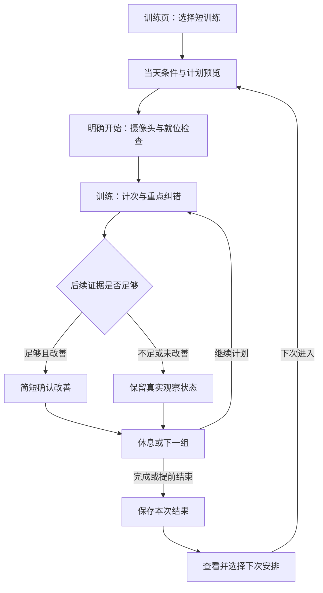

# Viaim Coach：短训练入口、改善确认与下次训练建议需求草案 v1

> 这份材料记录了 2026 年 11 月 2 日的评审背景和建议。文中对现状的描述以调研当天为准。现有功能见[使用指南](../../trial-guide.md)。

日期：2026-11-02。用途：产品需求评审。状态：未实现、未开展本轮真人验收。

本文件承接[同类产品调研与需求评估](competitor-requirements-assessment-2026-11-02.md)，以本次读取的当前源码为能力依据。所有新增流程、界面内容、阈值和验收指标均为建议需求；示例不是实际训练结果。三项能力组成同一训练流程，共用现有摄像头训练、语音、计划和记录。

**一、产品范围与用户结果**

目标用户：使用 Mac 和摄像头进行单人居家基础训练的人。办公场景先验证少量站立练习，不宣称提供完整的办公室运动课程。

期望结果：用户能选到符合当天条件的短练习；收到纠错后知道后续是否改善；练完后留下可执行、可修改的下次安排。

整体流程：训练页选择短训练 → 确认当天条件与计划 → 开启摄像头并就位 → 完成动作与反馈 → 休息/切组 → 保存本次结果 → 选择下次安排 → 下次打开时载入预览。

范围决策：沿用全屏摄像头、中央取景与现有训练操作；增加开始前的选择面板和结束后的总结卡。训练中在既有反馈区域显示改善信息，不新增常驻排行榜或多块提示面板。现有自由训练、手动计划、动作示范、安静/静音和暂停结束功能继续使用。

**二、现有能力与真实缺口**

| 环节 | 已有，可复用 | 需要新增 | 需要优化 |
| --- | --- | --- | --- |
| 训练选择 | 9 个动作、计划编辑/保存/载入、语音启动计划 | 审核后的短训练模板、当天条件、时长估计、计划预览 | 在训练页提供入口，减少首次填写组次；计划页保留详细编辑 |
| 开始训练 | 开启摄像头、准备检查、就位后计数 | 模板选择与本次训练的关联 | 摄像头失败后保留预览；已有训练时提供明确返回入口 |
| 计划执行 | 多动作、多组、自动休息和下一组、暂停/结束 | 本次计划快照、整段训练用时、下一动作预告 | 当前组与下一组区别更明确；切换为地面动作时给提前准备信息 |
| 动作纠错 | 实时问题、逐次结果、提示优先级与节流、可打断语音 | 纠错事项的后续观察、按项目判断可评估性、改善结果与证据 | 接通逐次问题与即时反馈；避免旧提示在改善后继续播报 |
| 训练小结 | 单组结果、下一组注意事项、整次组次汇总 | 持久化的本次总结、原计划完成情况、下次建议草稿 | 区分完成、提前结束、中断、未有效训练和保存失败 |
| 历史与资料 | 逐次记录、评分/节奏趋势、器械/偏好等资料 | 可追溯的建议依据、采纳状态、可选训练感受 | 只比较可比数据；当天条件不自动写成长久偏好 |

本次特别确认的边界：

- 计划执行中不能直接替换动作，组间休息时也不能直接改下一组目标或负重。因此首版把修改安排在开始前；中途可暂停或结束，不承诺实时重排整套计划。
- 当前主动纠错观察实时问题；幅度不足、动作过快等部分结果在完整一次动作结束时才产生。新增改善确认必须同时处理这两种来源。
- 当前“动作过快”结果依据发力阶段时长，不能直接当成“下放过快”的证据。第一轮暂不加入新的下放节奏改善规则。
- 俯卧撑当前可多视角计次，腰背判断要求侧面且身体线条可见。局部评价不等于完全不能评价，也不代表全身标准；新增状态须具体到评价项目。
- 当前保存计划只有名称、动作块等信息；单组记录有会话关联，但没有完整的原计划快照、纠错后观察或下次建议。仅拼接一段总结文字不足以支持新流程。

**三、A：短训练入口**

**A 的目标：从“我有多少时间、现在能怎么练”到一份可开始的计划。**

| 编号 | 需求 | 具体行为 |
| --- | --- | --- |
| A01 | 入口 | 训练未开始时显示“短训练”入口，与“自由训练”并列；计划页增加同源的“短训练模板”入口。训练中入口收起，结束后重新出现 |
| A02 | 最少条件 | 可用时间 10/15/20 分钟；器械为无器械/已有哑铃；地面动作为可接受/只站立。默认 10 分钟、无器械、只站立，默认值可见，不能伪装成用户既有偏好 |
| A03 | 条件复用 | 已明确保存的器械和偏好可以预填；从自由文本提取但不确定的信息应让用户轻量确认。既有动作限制不能被本次默认值覆盖 |
| A04 | 推荐结果 | 一次显示 1 个首选、最多 2 个备选，列出预计用时、器械、站立/地面要求、动作与组次。仅展示符合当天条件的已审核模板 |
| A05 | 预览与修改 | 支持切换时长版本、选择另一个模板、展开查看每组目标/休息/负重；“详细编辑”进入现有计划编辑器。修改后重新估算时间和检查条件 |
| A06 | 开始 | 点击“开始这套训练”才调用现有开始流程；开启摄像头、检查就位，再开始有效计次/计时。预览和浏览模板本身不启动训练 |
| A07 | 训练中衔接 | 显示当前动作/组次、整段计划进度；休息时显示下一动作、下一组目标及必要站位提示。计次继续遵循已选计划，不依赖自动猜测动作 |
| A08 | 结束 | 按计划完成则进入总结；提前结束只保存真实完成内容，显示“本次已结束”。不因原计划时间到达就强行截断正在完成的动作 |
| A09 | 收藏 | “保存为我的计划”为可选操作；不要求保存才能开始。模板和下次建议不能因为同名而覆盖现有手动计划 |

默认“只站立”用于减少第一次就需要移动摄像头的成本；用户选择地面动作后才出现对应模板。它不是体能或健康状态判断。对于没有任何匹配方案的条件组合，显示“当前没有符合这些条件的短训练”，给出修改条件和手动选动作入口，不放宽器械或动作限制。

**模板首版范围。** 建议先准备以下三个方向，逐个完成内容审核和真人验收后才展示，不以凑够数量为发布条件：

| 候选方向 | 动作范围 | 产品命名与限制 |
| --- | --- | --- |
| 站立深蹲练习 | 深蹲 | 如实说明为单动作练习，不命名为全身训练；不为了填满 20 分钟堆叠重复组数 |
| 无器械基础练习 | 深蹲、俯卧撑、平板支撑 | 明确需要地垫/地面空间及机位转换；用户表示做不了某动作时，引导换已审核模板，不把跪姿等未支持变式当成同一识别动作 |
| 哑铃基础练习 | 弯举、肩上推举 | 先确认器械及用户实际使用重量；无可靠重量信息时要求填写，不由模型推测。上架前核对两种动作的站位转换 |

具体组数、次数、支撑时长、休息和版本跨度是模板必须填写的发布内容，本轮不把尚未经过专业内容审核与真人试用的数值包装成正式训练方案。模板版本只从已审核配置选择，不按“时间翻倍=训练量翻倍”生成。

时间选项表达“今天可用的时间”，模板可以短于它；卡片必须显示实际估计范围。某模板没有匹配版本时不显示该版本，不能承诺每个模板都恰好提供 10/15/20 分钟。

**A 的具体交互。**

1. 用户在未开始的训练页点击“短训练”。底部或侧边展开选择面板，仍可看到原训练页。
2. 面板显示三个当天条件；用户可以不修改默认值直接查看推荐。无可用模板时在此结束推荐，不弹开摄像头。
3. 用户选择一套计划，查看动作顺序、目标、休息、预计用时和站位要求。首次出现的动作可打开现有动作参考。
4. 点击“开始这套训练”。如果已有正在进行或暂停的训练，则显示“继续当前训练”与“结束并保存当前训练”；后者完成后回到新计划预览，不再自动连带启动新计划。
5. 摄像头就绪后按现有准备检查训练。开启失败或用户取消连接时保留计划，提供“重试”和“返回调整”。
6. 每组结束进入现有休息。补充“接下来：动作/第几组/目标”；下一动作要求地面或转身时提前提示，休息结束后仍必须通过准备检查才能计数。
7. 完成或提前结束后进入 C 的结果卡，已完成组不重复归档。

**时长规则。**

- 开始前估计包含常规设备/就位准备、动作执行、必要休息和动作转换；首次权限处理不承诺固定耗时。
- 新增“本次用时”从用户明确开始、应用接受启动请求并进入准备阶段时计算，到结束为止，含准备、休息和主动暂停的真实时间；原有组内时间与有效支撑时间维持独立口径。仅连接失败或取消且没有有效动作时，不形成已完成训练成果。
- “预计还需”按未完成计划估算，暂停时不倒扣，恢复后更新；与本次用时区分。初版无个人历史时用经试用校准的模板范围，有历史后才优化估计。
- 到达用户可用时间而未完成时，在动作间隙/休息处一次提示“已到你预留的时间，可继续或结束并保存”；不自动加速、不减少休息、不强停半次动作。
- 本轮不新增通用热身/拉伸计时编排。不在可识别动作列表外隐式加入会被计次或评分的动作；需要这些阶段的模板应另立内容与流程需求，不冒充完整课程。

**四、B：纠错后的改善确认**

**B 的目标：围绕一个具体问题形成有证据的提示与后续反馈。** 该能力适用于符合条件的自由训练和计划训练，不要求用户必须从短训练进入。

| 编号 | 需求 | 具体行为 |
| --- | --- | --- |
| B01 | 可评估项目 | 按动作、视角和当前关键部位可见性决定某项是否可评估；能计次但不可评价时，保持计次并明确评价范围 |
| B02 | 聚焦一个问题 | 使用现有提示优先级，每次只跟踪一个重点；完成次数、暂停/结束、就位等信息仍优先，不能被改善反馈遮挡 |
| B03 | 问题成立 | 连续帧问题和完整动作后问题统一进入观察。单次抖动不触发改善事项；优先补充逐次问题的反馈接入 |
| B04 | 提示后观察 | 记录提示对应的问题、有效展示/播报时点及后续有效重复；提示前或提示进行中的动作不作为“收到提示后改善”的证据 |
| B05 | 改善成立 | 足够的后续有效重复达到同一项目的改善条件时，显示一句具体结果；不使用总评分升高替代项目证据 |
| B06 | 无法判断 | 遮挡、转身、机位变化或跟踪切换时，暂停判断；恢复后重新累计可比较重复，不把缺失信号算作通过 |
| B07 | 提示呈现 | 复用现有动作反馈/字幕区域。改善消息短暂显示并进入本组小结；不弹模态框、不强制开参考视频 |
| B08 | 语音与打断 | 沿用既有提醒密度、静音和打断；改善播报与纠错共用队列，清除同一问题未播出的旧纠错，播放前再次核对当前状态 |
| B09 | 结果保存 | 将观察结果关联至本次训练、组、动作和证据重复。仅有结果不够，历史需能解释其来源 |

**首轮候选评价项目。** 下表为逐项验证清单，不代表当前准确率已达到可发布水平：

| 动作/项目 | 现有可复用依据 | 新增重点 | 不能给出的结论 |
| --- | --- | --- | --- |
| 侧面深蹲：动作幅度 | 每次动作的幅度/最低参考角度、完整性及幅度不足结果 | 接通逐次结果到提示；在同一视角下比较后续有效重复，区分有所改善与已达到当前规则范围 | 不能由幅度改善推断整体动作标准；不能要求越深越好 |
| 侧面俯卧撑：身体直线 | 身体线条可见性、侧面判断、塌腰相关提示 | 保存每次动作是否有足够腰背观察证据，只有该项目持续可评估时才比较 | 正面/斜侧面计次正常不代表可判断腰背；不增加手肘外展结论 |
| 二头弯举：肘部摆动 | 当前上臂摆动相关问题、逐次错误记录 | 保留该项的有效观察范围与指标；排除转身/肩肘遮挡造成的假改善 | 不由肘部更稳定推断重量合适或全部动作标准 |

平板支撑的持续姿态改善需要单独的时间窗口和证据口径，本轮保留既有计时/反馈，暂不套用“连续几次”的新规则。下放节奏改善也不纳入首轮，避免混用现有发力阶段的速度判断。

**建议的初始观察规则，用于后续标注验证和调参，不是已验收算法：**

1. 初始问题门槛：同一项目在最近 3 次可评估的完整动作中至少 2 次出现，才建立新的纠错事项。现有必要的就位和即时提醒仍可正常工作。
2. 对于已通过连续帧触发的提示，可以记录提示事件，但若缺少足够提示前数据，不得事后声称“比之前改善”。
3. 提示应在动作间隙简短给出。语音关闭时以可见文字为提示时点；控件隐藏且语音关闭时只记录观察，不标记用户已收到提示。
4. 提示送达后，从下一次完整动作开始累计。连续 3 次可评估动作符合该项目标准，且与提示前证据可比，才确认改善；中间出现该问题则重新累计。
5. 每个项目必须定义自己的改善阈值、误差余量和适用视角；不存在通用的“角度变了几度就变好”。只有问题未出现而无有效观察证据，不满足条件。
6. 遮挡/失去姿态、换机位、明显换视角、换动作或跟踪对象异常会清空连续样本。重新就位后可以继续该事项，但不得跨越不可比较的条件拼出改善。
7. 每组同一项目最多一次主动改善播报；整组最多一次新的重点纠错事项。后续仍有问题时可依现有规则提示，新的改善事项留到下一组评估。
8. 组结束时不足 3 次后续有效动作，结果为“观察不足”，不增加次数要求用户补齐；不能确认时就不表扬已改善。
9. 当改善已确认但之后再次出现问题，小结写“曾改善，后续仍有波动”；不撤销真实观察，也不把早先改善概括为整组始终改善。

**B 的状态与用户反馈。**

| 状态 | 用户可见行为 | 进入下一状态 |
| --- | --- | --- |
| 正常观察 | 保持既有计次和反馈 | 同一项目满足问题门槛 |
| 已提示、待观察 | 一句具体提示，如“在舒适范围内，注意这次动作幅度” | 收到足够后续有效动作 |
| 暂时看不清 | 就位/可见性提示优先，不播报“已改好” | 重新就位后开始新的连续观察 |
| 已确认改善 | 如“后面三次的幅度比前面更一致了”，仅在证据支持相应描述时出现 | 后续继续训练，结论进入本组小结 |
| 仍需留意 | 到休息时给一句下一组重点，可选“查看示范” | 用户自行查看，或下一组再次观察 |
| 观察不足 | 训练中无需额外播报，详情中解释“后续有效动作不足” | 本组结束后关闭事项 |

每个项目的反馈文案必须匹配实际测量：测到幅度达到范围就说幅度，测到稳定性改善才说稳定性。不得把“没有触发错误”写为“完美”“完全标准”。

**B 的具体交互。**

连续动作暴露同一可观察问题 → 在间隙给一句提示 → 用户继续完成原定动作 → 可见时持续观察、不可见时先引导站位 → 足够证据后一句改善确认 → 休息时显示本组结果。

当用户点击“查看示范”时，打开现有参考卡；如正在训练或休息，先暂停训练/休息计时，关闭示范后由用户明确继续。用户原本自行打开参考卡的行为仍沿用既有设置；这里只定义从纠错学习入口进入的行为，不能把所有看参考操作都改为自动暂停。

安静模式保留必要纠错，改善以文字/组后结果为主；适中和积极模式每组最多播报一次改善。明确关闭纠错时不新建主动纠错事项，也不主动播报改善；静音只影响声音。用户随时可通过现有暂停、结束或停止播报控制打断。

**五、C：下次训练建议**

**C 的目标：把这次真实表现转成用户可采纳的一份下次训练草稿。** “下次”不绑定日期，也不代表马上再练；不创建日历或提醒。

| 编号 | 需求 | 具体行为 |
| --- | --- | --- |
| C01 | 本次总结入口 | 训练结束后原训练页显示结果卡，用户可收起；历史页可按本次训练再次打开。查看总结不改变摄像头/麦克风开关 |
| C02 | 结果三部分 | 完成情况；最多一个有证据的改善/待留意点；一份下次计划草稿。没有动作质量证据时只总结真实训练量，不强凑进步 |
| C03 | 可选感受 | 提供“轻松/合适/吃力”单选，可跳过、可修改；与本次训练绑定，不自动变为长期身体事实 |
| C04 | 建议内容 | 展示动作、组次、时长估计、器械和练习重点，并用一句话说明依据。与上次不同的项目单独列出 |
| C05 | 用户操作 | “设为下次训练”“调整”“暂不安排”；采纳后确认“已设为下次训练”，不启动摄像头、不开始计次 |
| C06 | 再次进入 | 未开始训练时优先显示已选的“下次训练”；点击进入预览，重新确认当天条件，再点击开始 |
| C07 | 建议更新 | 新训练/新感受可刷新未采纳草稿；已采纳计划不静默改写。用户修改器械或动作限制后重新检查其可执行性 |
| C08 | 保存与撤销 | 采纳和调整均需保存成功才显示成功；可撤销选择。另存为我的计划使用现有保存能力，并避免同名隐式覆盖 |
| C09 | 数据不足 | 首次训练可建议重复同一模板，但只说明尚在建立记录；旧导入记录可用于可用的训练量统计，不补造纠错事件或完整计划 |

结果卡示意：

> 本次已结束：完成 4/5 组，最后一组提前结束。  
> 本次重点：已观察到某项改善；或“有效观察不足，暂不比较动作质量”。  
> 下次建议：沿用这套练习，继续关注一个已确认的练习重点。  
> 可选感受：轻松 / 合适 / 吃力。  
> 操作：设为下次训练 / 调整 / 暂不安排。

以上为结构示意。实际完成组与部分完成组要分开统计，某组完成一部分不能算作整组达成目标。若用户修改了本组目标，记录实际目标与修改，不能为了让结果好看事后改写原计划。

首版优先使用本次可核对结果，不要求一定得出跨次进步结论。若展示与上次的质量比较，须满足同动作、相同负重与目标口径、可比较视角、相同评价规则版本及足够有效观察；条件不符时分别展示事实，不合成“变强/变差”的判断。当前历史页的最近三组与此前三组统计不能未经筛选直接作为建议依据。

自由训练也可以生成结果卡：单动作训练可用用户已确认的目标生成单动作草稿，不能把实际未完成次数误当下次目标；多动作自由训练没有原计划快照时，提供匹配的已审核模板或手动整理入口，不从动作出现顺序反推用户原定计划。

**首版建议决策表。** 由明确规则选择计划与依据，语言模型可用于表达、解释和解析意图，不能自行编造完成情况或改变计划数值。无需模型响应也应能展示基础结果与合规模板建议。

| 输入情况 | 默认建议 | 禁止推断或操作 |
| --- | --- | --- |
| 正常完成，感受合适或未填写 | 沿用当前已审核计划；有持续问题则突出一个练习重点 | 不因完成一次就自动增加训练量 |
| 已确认某项改善 | 沿用计划并巩固该项；描述局部证据 | 不把一次局部改善表述为整体能力提升 |
| 同一问题反复出现，但可完成 | 保持计划或提供已审核较轻版本供选择；下一次集中一个重点 | 不从单项错误直接诊断原因，不频繁切换陌生动作 |
| 用户反馈吃力 | 优先展示同模板的已审核较轻版本，标明变化；无版本则提供详细调整，不声称已减量 | 不直接执行新计划，不用统一百分比任意减重 |
| 用户反馈轻松 | 仍默认沿用；给“调整目标”的入口 | 首版不自动加重量/加次数，不因一次口头反馈判断已具备进阶条件 |
| 提前结束，明确说时间不够 | 下次优先选择符合新时间条件的较短版本 | 不把时间不足判断为体能不足 |
| 提前结束，原因未知 | 展示原计划供调整；可选标记原因，允许跳过 | 不自行猜测疲劳或不喜欢 |
| 摄像头失败/有效动作不足 | 先提供就位帮助或重试入口；仍可查看计划 | 不据此建议降级体能或声称动作变差 |
| 用户主动表示疼痛或不适 | 沿用现有暂停/结束处理；暂不自动提供继续挑战的计划 | 不诊断，不自动替换动作鼓励继续练 |
| 条件或限制与已采纳计划冲突 | 明示冲突，停止把它作为可直接开始的推荐，提供调整入口 | 不静默取消限制或隐式替换原计划 |

当多个输入同时出现，优先处理用户不适/明确限制，其次是数据是否足够，再处理当天时间器械，最后考虑感受和动作表现。例如同时“时间不够”和“吃力”时，应选择同时符合两种条件的审核版本；没有匹配版本则让用户调整，不自行拼接。

**C 的具体交互。**

1. 自动完成或用户结束后，先保存本次记录，再显示总结。保存失败时标记“记录待保存”，保留重试，不声称已保存或已设置下次计划。
2. 用户可以直接阅读结果，也可选择本次感受；选择后只刷新尚未采纳的建议草稿，并让变化可见。
3. 点击“设为下次训练”，保存该草稿的完整内容和来源；同一账户本机只保留一个当前已采纳的下次安排。替换时明确“替换下次安排”，可撤销。
4. 点击“调整”，进入与 A 相同的预览/修改流程；修改后的计划有自己的版本，旧训练事实不被改写。
5. 下次打开训练页显示“上次选好的训练”，简要列出预计时长、动作与重点；用户可开始预览、调整或撤销安排。
6. 开始前根据当前器械/限制核对。开始成功后将该安排标记为使用中；本次结束保存后，由新结果产生下一份草稿。中断恢复时提供重新查看/开始，不自动续接计数。

历史中的原建议保留为当时记录；新的已采纳安排与历史分开。用户删除来源训练记录时，对应的改善依据和建议理由也须移除/失效，不能留下带已删除数据的解释。计划本身若被用户另存，可以保留，但应去掉失效来源。

**六、跨功能的语音与状态约定**

| 用户表达 | 应有行为 | 当前能力关系 |
| --- | --- | --- |
| “帮我安排十分钟训练” | 打开/生成符合当前条件的预览，简短说明计划；不立即开始 | 新增推荐预览意图，复用现有对话 |
| “就按这个开始” | 当前有唯一、未失效的预览时启动；否则只问缺少的必要信息 | 复用开始计划，新增预览上下文 |
| “我只有十分钟，开始一套站立练习” | 约束、器械与唯一模板明确且无冲突时可直接启动并说明采用内容；否则先给预览 | 明确开始意图可减少一次确认，但不得猜测负重或忽略限制 |
| “这次幅度改好了吗” | 查询当前具体纠错事项，回答已观察到的结果或观察不足 | 新增改善结果查询 |
| “少说一点” | 沿用安静模式，停止主动改善播报；保留必要纠错和文字 | 复用现有提醒密度 |
| “再给我看一下示范” | 通过本次纠错学习入口先暂停，打开对应动作参考；明确继续后恢复 | 复用参考与暂停，新增学习入口协调 |
| “下次继续这套” | 保存为下次安排，回答设置结果，不开始新一组 | 新增下次安排意图，不能误用“再来一组” |
| “下次短一点” | 展示较短审核版本及差异；如用户明确选中再保存 | 新增建议调整，复用计划预览 |
| “这次有点吃力” | 作为本次感受保存，按规则刷新草稿 | 新增训练感受，不调用长期记忆保存 |
| “先别改”“只是问问能不能” | 不修改计划或训练状态 | 沿用现有否定/咨询边界 |
| “今天就到这里” | 结束并保存真实完成部分，进入结果卡 | 复用现有结束训练 |

语音服务不可用时，三个功能仍有按钮/文字路径；改善观察继续在本机工作，基础建议由规则与模板生成。用户说话、暂停或结束时，旧生成结果和待播报改善消息必须失效，不允许延迟回来覆盖新状态。

**七、需要新增的记录，不限定实现结构**

| 信息 | 为什么需要 | 最小内容 |
| --- | --- | --- |
| 短训练模板 | 筛选、估时、内容审核 | 标识与版本、可用动作、器械、地面要求、组次/休息/负重配置、时长估计来源、可用状态 |
| 本次训练概况 | 还原原定与实际完成情况 | 本次标识、来源模板/手动计划快照、当天条件、开始结束时间、结束原因、完成/部分完成情况、保存状态 |
| 纠错事项 | 支持改善查询和总结 | 项目、动作与组、提示送达方式/时间、前后有效观察、可评估条件、结果及规则版本、失效原因 |
| 本次感受 | 区分主观感受和客观记录 | 轻松/合适/吃力、用户主动说明的结束原因、更新时间；跳过就是未知 |
| 下次安排 | 重开可见、可撤销、避免重复执行 | 计划内容与版本、来源事实、一句话理由、差异、草稿/已采纳/使用中/已使用/已撤销/需重新确认状态 |

继续保留现有逐组与逐次记录。新增信息需要随完整 JSON 备份/恢复，重复导入不能重复创建本次训练或覆盖本机更新的选择。CSV 仍仅承载既有可交换记录，不承诺保存全部改善事项和建议。旧数据缺少新字段时保持可读，以“无此项记录”呈现，不回填虚构结论。

不要求保存原始视频。首先保存足以解释结果的有限指标、可评估标记和事件关联；每种指标的来源和有效范围必须清楚。用户选择的长期资料、当天条件、本次感受分开管理。

**八、首版验收场景**

| 编号 | 场景 | 必须满足的结果 |
| --- | --- | --- |
| A-T01 | 新用户选择 10 分钟、无器械、只站立 | 仅展示满足条件的审核模板；可直接预览，不需先填全部组次 |
| A-T02 | 没有匹配模板 | 明确说明没有合适方案，允许改条件；不偷偷推荐地面动作或器械动作 |
| A-T03 | 摄像头拒绝授权/用户取消连接 | 保留预览；不开始计次、不产生虚假完成记录；可重试 |
| A-T04 | 当前已有训练或暂停中的计划 | 返回当前训练，或显式结束保存后回新计划预览；不覆盖当前进度 |
| A-T05 | 从站立动作转地面动作 | 休息时提前说明下一动作与机位；未通过就位检查不计次 |
| A-T06 | 到预留时间尚未完成 | 动作间隙提示一次；不强停半次、不自动缩短休息 |
| A-T07 | 保存与已有计划同名 | 不隐式覆盖；用户可另存或明确替换 |
| B-T01 | 同一问题多次出现，提示后连续有效改善 | 仅生成一次对应事项和一次改善播报，证据可回查 |
| B-T02 | 提示后突然丢点/转身 | 不判改善；恢复后从可比较的有效动作重新累计 |
| B-T03 | 俯卧撑正面可计数、腰背不可评估 | 计数继续；不声称腰背问题改善 |
| B-T04 | 改善发生但新问题同时出现 | 只能描述具体项目；必要纠错优先，不夸整体动作标准 |
| B-T05 | 组即将结束，只有 1—2 次后续有效动作 | 记录观察不足，不延长训练、不编造改善 |
| B-T06 | 用户打断/切组/结束时还有待播报消息 | 旧纠错和改善不再播出，不串到下一组 |
| B-T07 | 安静/静音/关闭纠错/隐藏控件 | 各开关语义一致；未送达提示不记录成用户收到后改善 |
| B-T08 | 后续再次出现已改善的问题 | 小结如实记录“曾改善、后续仍有波动” |
| C-T01 | 计划正常结束，记录保存成功 | 真实完成情况、最多一个重点、一份可查看的下次草稿 |
| C-T02 | 用户提前结束或应用异常中断 | 与正常完成区分；未完成组不当作目标已完成 |
| C-T03 | 一次高分或用户说轻松 | 不自动增加组次和负重；只给沿用或调整入口 |
| C-T04 | 选择设为下次训练后重开应用 | 内容可恢复；不自动开摄像头、不自动开始 |
| C-T05 | 已采纳后用户又完成新训练/改资料 | 不静默改写已选计划；存在冲突时标记需重新确认 |
| C-T06 | 记录或建议保存失败 | 清楚显示待保存/失败，重试成功后才确认；不得重复创建 |
| C-T07 | 语音服务离线 | 按钮流程、基础总结与规则建议仍可完成 |
| C-T08 | 旧 JSON/CSV 导入、重复导入或删除来源记录 | 不虚构新证据、不重复建议；删除后不继续引用失效事实 |

真人验证先覆盖 6—8 位目标用户，用于发现流程问题，不用于推断市场规模。首版改善确认还需要独立标注素材，按“动作 × 评价项目 × 视角”分别报告提示精确率、改善确认精确率、有效观察覆盖率和样本量，不把所有项目混成一个平均值。

建议将改善确认精确率 ≥90% 作为初始目标，同时要求各项目在人工确认的改善机会中至少覆盖 60%，并披露独立用户数和有效事件数；样本不足或通过率不足的项目继续关闭。两个百分比都是拟议试点门槛，需由首轮标注结果检视，不代表临床标准或当前成绩。不得通过几乎不提示来制造高精确率。

流程指标以当前产品为基线：记录设备已就绪后开始第一组的耗时、计划选择耗时、独立完成率、误计漏计、提示打扰、对下次建议的理解与实际采纳。两周回访观察是否主动再练以及未再练原因，不把点击采纳视为持续使用。

**九、首版范围与推进依赖**

本期必须有：少量已审核短训练、条件筛选与预览、原计划/实际训练关联、当前/下一组信息、逐项开放的改善确认、可保存的结果卡、一份可采纳的下次安排、按钮与语音一致性，以及失败/中断/数据恢复处理。

本期明确暂缓：运动中重排整套计划、自动增加训练负荷、所有动作统一改善评分、平板持续姿态改善新算法、下放节奏改善新规则、未识别动作的热身/拉伸编排、周历提醒和跨设备健康数据。

产品流转依赖是 A 的实际训练记录为 B 和 C 提供上下文；B 的可靠结果可以增强 C，但 B 暂不可评估时 C 必须仍能基于真实完成情况提供保守的沿用建议。三项不应互相阻塞基本使用。

进入实现前需要形成的具体材料是：通过审核的模板配置、每个候选改善项目的可评估/失效/确认规则与标注样本、A/B/C 的静态流程评审。默认入口和操作语义已在本草案提出，可按评审结果调整；未定的是需真人和内容证据支持的阈值与训练配置，不需要先靠写代码决定。

**附：本轮核对的实现依据**

- [训练页与现有休息覆盖层](../../../desktop/src/components/TrainingStage.tsx)：当前休息倒计时、训练控制和参考卡。
- [计划预览与开始入口](../../../desktop/src/components/Features.tsx)：已有组次、动作顺序、计划启动和载入。
- [训练计划执行与切组](../../../desktop/src/core/session.ts)：自动休息、切组与结束。
- [计划中修改边界](../../../desktop/src/core/session.ts)：开始前条件、计划中换动作限制和休息时修改限制。
- [逐次幅度与速度结果](../../../desktop/src/core/engine.ts)：完整一次动作才形成的结果，以及发力阶段过快的现有含义。
- [俯卧撑可评估范围](../../../desktop/src/core/pushup.ts)：侧面与身体线条可见性限制。
- [现有主动纠错](../../../desktop/src/core/interaction.ts)：实时问题、提示间隔与优先级基础。
- [现有总结](../../../desktop/src/App.tsx)：单组提示与整次完成汇总。
- [当前记录与保存计划](../../../desktop/src/core/data.ts)：已有组/次记录与计划字段。
- [同名计划保存行为](../../../desktop/src/core/data-edits.ts)：生成建议需避免无意覆盖同名手动计划。

本轮只新增本需求草案，未修改应用代码、安装依赖、运行构建或发布。
